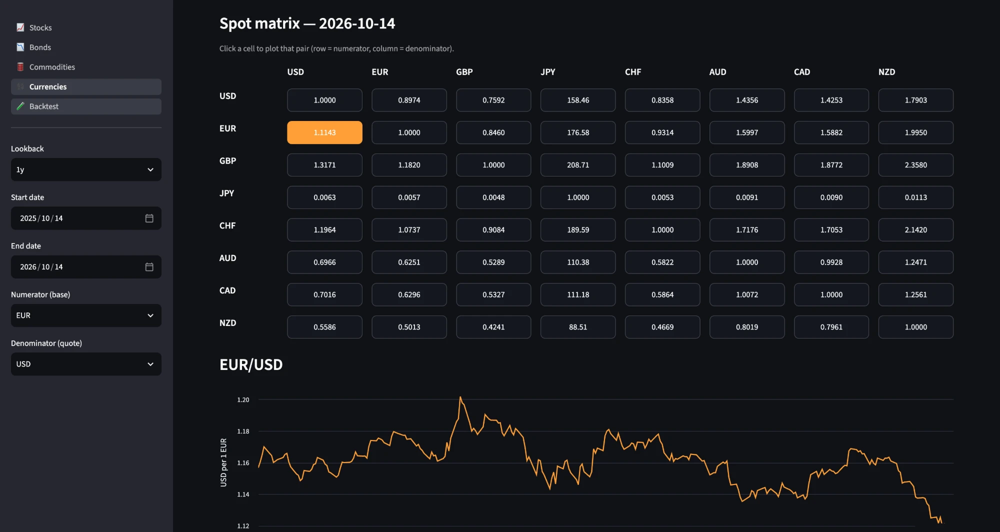
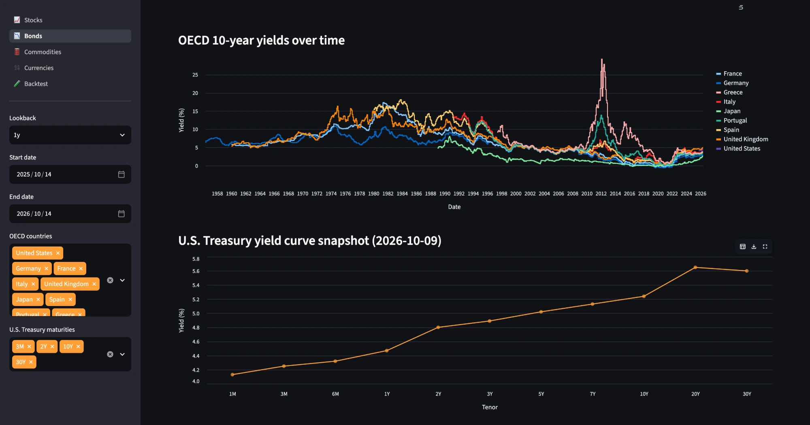
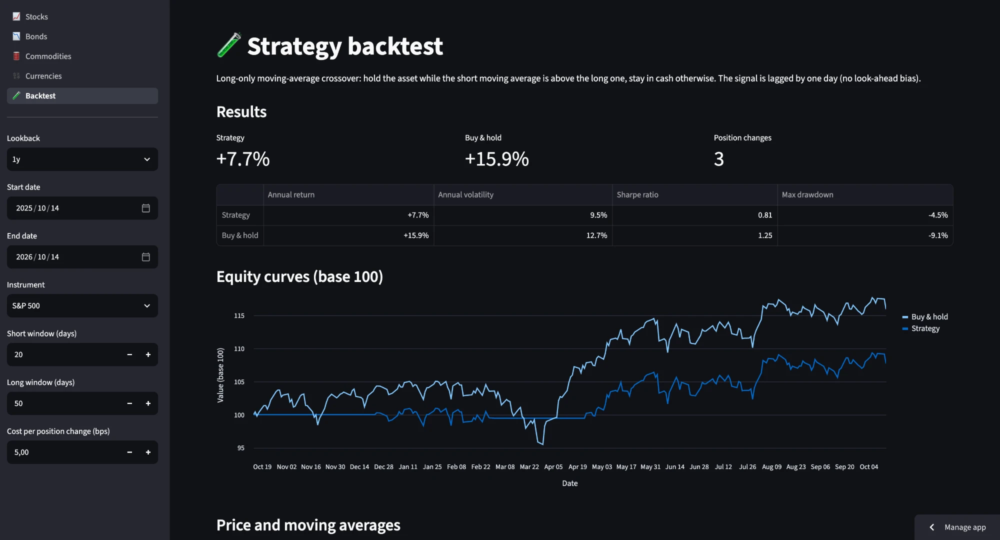

# 📊 Market Dashboard

[](https://github.com/moraztom31/market-dashboard/actions/workflows/ci.yml)


🔗 **[Voir l'application en ligne](https://market-dashboard-nnfptzqw97h44exkpyhemg.streamlit.app/)**

Interactive cross-asset market dashboard built with **Streamlit**: compare stocks,
bonds, commodities and currencies, measure risk and test a simple trading strategy.
Data comes from **Yahoo Finance** (`yfinance`) and **FRED**.

## Screenshots

| Currencies: clickable spot matrix | Bonds: Treasury curve and OECD yields |
|---|---|
|  |  |



## Features

| Page | What it shows |
|------|---------------|
| **Overview** | Snapshot of key markets (S&P 500, Nasdaq, US 10Y yield, gold, oil, Bitcoin, EUR/USD, USD/JPY) with daily moves, indexed performance and returns |
| **Stocks / Commodities** | Latest prices, trailing (7d, 30d, 90d, 1y) and calendar (WTD, MTD, QTD, YTD) returns as tables and bar charts, indexed price history |
| **Bonds** | OECD 10-year yields (snapshot + history), U.S. Treasury yield curve (snapshot + history) from FRED |
| **Currencies** | Clickable spot cross-rate matrix for 8 currencies and the history of the selected pair |
| **Portfolio** | Long-only all-weather portfolio: 40% World equities / 30% Government bonds / 30% Commodities benchmark vs custom, max-Sharpe, min-volatility and inverse-volatility allocations, with risk-return scatter, allocations and correlations |
| **Backtest** | Long-only moving-average crossover vs buy & hold, with transaction costs, equity curves and risk metrics |
| **Explorer tab** (Stocks, Commodities, Bonds) | Form to pick instruments and dates, normalise to base 100, add short/long moving averages, then get annualised return, volatility, Sharpe ratio, max drawdown, correlation heatmap and drawdown chart |

## Run locally

```bash
git clone https://github.com/moraztom31/market-dashboard.git
cd market-dashboard
pip install -r requirements.txt
python3 -m streamlit run app.py
```

## Project structure

```
app.py                  # entry point: page navigation
dashboard/
  config.py             # instruments, data sources, colours
  data.py               # Yahoo Finance / FRED downloads (cached)
  analytics.py          # returns, risk metrics, backtest (pure pandas)
  validation.py         # input validation
  charts.py             # Altair charts and styled tables
  explorer.py           # form-based explorer
  views/                # one module per page
tests/                  # pytest suite (no network: data sources are mocked)
```

## Tests

```bash
pip install -r requirements-dev.txt
pytest
```

The suite covers the analytics (returns, drawdown, volatility, correlation,
backtest), input validation and a smoke test of every page. GitHub Actions runs
it on every push.

## Disclaimer

For educational purposes only. This is not investment advice; past performance
does not predict future results. Data is provided by Yahoo Finance and FRED and
may be delayed or inaccurate.
